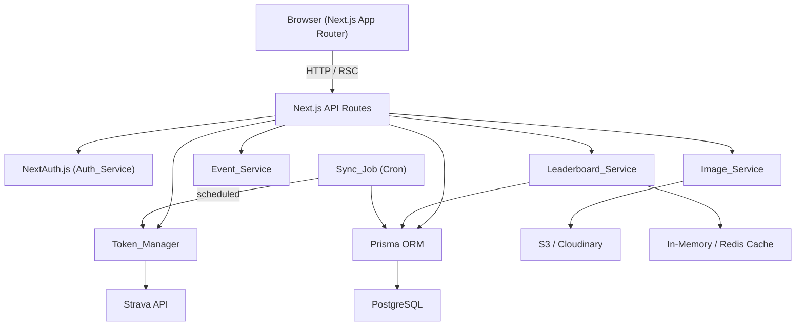

# Design Document

## Overview

The Running Club Web Application is a full-stack Next.js application that enables club members to authenticate, connect their Strava accounts, view personal activity dashboards, compete on a leaderboard, and RSVP to club events. Admins can manage events and users through a dedicated panel.

The system is built on Next.js (App Router) with API routes serving as the backend, NextAuth.js for session management, Prisma ORM over PostgreSQL for persistence, and a background cron job for Strava activity synchronization. Image uploads are delegated to an external storage provider (AWS S3 or Cloudinary).

### Key Design Decisions

- **Next.js App Router**: Enables server components for data fetching close to the database, reducing round trips and simplifying auth checks via server-side session access.
- **NextAuth.js JWT strategy**: Stateless sessions avoid a session table; role and Strava connection status are embedded in the JWT and refreshed on each request.
- **Prisma + PostgreSQL**: Type-safe queries, migration tooling, and relational integrity for users, events, RSVPs, and cached activities.
- **Leaderboard caching in-process**: A simple in-memory TTL cache (or Redis if available) avoids redundant aggregation queries for the 5-minute window required by the spec.
- **Strava token refresh at request time**: Tokens are checked and refreshed lazily before each Strava API call, keeping the Token_Manager logic centralized.
- **Cron via Vercel Cron / node-cron**: The Sync_Job runs as a Next.js API route triggered on a schedule, keeping infrastructure simple.

---

## Architecture



### Request Flow

1. Browser sends a request (page navigation or API call).
2. Next.js middleware checks the NextAuth session; unauthenticated requests are redirected to `/login`.
3. Role checks are enforced in middleware for `/admin/*` routes (403 if role ≠ "admin").
4. API route handlers call the appropriate service (Event_Service, Leaderboard_Service, etc.).
5. Services interact with Prisma for persistence and with external APIs as needed.
6. The Sync_Job runs independently on a cron schedule, calling the Strava API and upserting CachedStravaActivity records.

---

## Components and Interfaces

### Auth_Service (NextAuth.js)

Configured in `lib/auth.ts` and exposed via the NextAuth route handler.

**Providers**:
- `CredentialsProvider` — email + bcrypt password verification
- `GoogleProvider` — Google OAuth 2.0
- `StravaProvider` (custom OAuth provider) — Strava OAuth 2.0

**Callbacks**:
- `jwt` — embeds `userId`, `role`, and `stravaConnected` into the JWT on sign-in and on each token refresh.
- `session` — exposes `userId`, `role`, and `stravaConnected` to the client session object.
- `signIn` — handles account linking (Google → existing email/password account).

**Key functions**:
```ts
// lib/auth.ts
export const authOptions: NextAuthOptions = { ... }

// Utility used by API routes and server components
export async function getRequiredSession(): Promise<Session>
export async function requireAdmin(): Promise<Session>
```

### Token_Manager

Responsible for Strava token lifecycle. Lives in `lib/strava/token-manager.ts`.

```ts
export async function getValidStravaToken(userId: string): Promise<string>
// Checks stravaExpiresAt; if expired, calls Strava /oauth/token with grant_type=refresh_token,
// updates DB, returns fresh access token. Throws StravaAuthError if refresh fails.

export async function saveStravaTokens(userId: string, tokens: StravaTokens): Promise<void>
export async function revokeStravaTokens(userId: string): Promise<void>
```

### Strava_Client

Thin HTTP client wrapping the Strava API. Lives in `lib/strava/client.ts`.

```ts
export async function fetchRecentActivities(accessToken: string, after: number): Promise<StravaActivity[]>
export async function fetchAthleteStats(accessToken: string, athleteId: number): Promise<StravaStats>
```

### Leaderboard_Service

Aggregates CachedStravaActivity records and caches results. Lives in `lib/leaderboard.ts`.

```ts
export type LeaderboardFilter = 'weekly' | 'monthly' | 'all-time'
export type LeaderboardSort = 'distance' | 'movingTime' | 'pace' | 'elevationGain'

export async function getLeaderboard(
  filter: LeaderboardFilter,
  sort: LeaderboardSort
): Promise<LeaderboardEntry[]>
// Returns cached result if TTL has not expired; otherwise queries Prisma and caches.
```

Cache key: `leaderboard:{filter}:{sort}`. TTL: 5 minutes.

### Event_Service

CRUD for events and RSVPs. Lives in `lib/events.ts`.

```ts
export async function listUpcomingEvents(): Promise<Event[]>
export async function createEvent(adminId: string, data: CreateEventInput): Promise<Event>
export async function updateEvent(eventId: string, data: UpdateEventInput): Promise<Event>
export async function deleteEvent(eventId: string): Promise<void>
export async function upsertRsvp(userId: string, eventId: string, status: RsvpStatus): Promise<Rsvp>
export async function getRsvpCounts(eventId: string): Promise<RsvpCounts>
```

### Image_Service

Handles multipart uploads to S3 or Cloudinary. Lives in `lib/image-service.ts`.

```ts
export async function uploadEventImage(file: File): Promise<string>
// Returns the public URL of the uploaded image. Throws ImageUploadError on failure.
```

Provider is selected via `IMAGE_PROVIDER` env var (`s3` | `cloudinary`).

### Sync_Job

Exposed as a Next.js API route at `app/api/cron/sync-strava/route.ts`, protected by a `CRON_SECRET` header.

```ts
// Pseudocode
for each user with valid stravaId:
  try:
    token = getValidStravaToken(user.id)
    activities = fetchRecentActivities(token, lastSyncTimestamp)
    upsert activities into CachedStravaActivity
  catch StravaAuthError:
    log and skip user
  catch RateLimitError:
    log and break loop
```

### Middleware

`middleware.ts` at the project root:
- Redirects unauthenticated users to `/login` for protected routes.
- Returns 403 for users without the "admin" role on `/admin/*` routes.
- Uses `getToken()` from `next-auth/jwt` for edge-compatible session reads.

---

## Data Models

Defined in `prisma/schema.prisma`.

```prisma
model User {
  id                  String    @id @default(cuid())
  name                String?
  email               String    @unique
  emailVerified       DateTime?
  image               String?
  bio                 String?
  passwordHash        String?
  role                Role      @default(USER)
  stravaId            String?   @unique
  stravaAccessToken   String?
  stravaRefreshToken  String?
  stravaExpiresAt     DateTime?
  stravaConnected     Boolean   @default(false)
  createdAt           DateTime  @default(now())
  updatedAt           DateTime  @updatedAt

  accounts            Account[]
  sessions            Session[]
  rsvps               Rsvp[]
  cachedActivities    CachedStravaActivity[]
  createdEvents       Event[]   @relation("EventCreator")
}

enum Role {
  USER
  ADMIN
}

model Account {
  id                String  @id @default(cuid())
  userId            String
  type              String
  provider          String
  providerAccountId String
  refresh_token     String?
  access_token      String?
  expires_at        Int?
  token_type        String?
  scope             String?
  id_token          String?
  session_state     String?

  user User @relation(fields: [userId], references: [id], onDelete: Cascade)

  @@unique([provider, providerAccountId])
}

model Session {
  id           String   @id @default(cuid())
  sessionToken String   @unique
  userId       String
  expires      DateTime
  user         User     @relation(fields: [userId], references: [id], onDelete: Cascade)
}

model Event {
  id          String   @id @default(cuid())
  title       String
  description String?
  dateTime    DateTime
  location    String
  imageUrl    String?
  creatorId   String
  createdAt   DateTime @default(now())
  updatedAt   DateTime @updatedAt

  creator     User     @relation("EventCreator", fields: [creatorId], references: [id])
  rsvps       Rsvp[]
}

model Rsvp {
  id         String     @id @default(cuid())
  userId     String
  eventId    String
  status     RsvpStatus
  createdAt  DateTime   @default(now())
  updatedAt  DateTime   @updatedAt

  user       User       @relation(fields: [userId], references: [id], onDelete: Cascade)
  event      Event      @relation(fields: [eventId], references: [id], onDelete: Cascade)

  @@unique([userId, eventId])
}

enum RsvpStatus {
  JOINED
  MAYBE
  CANCELED
}

model CachedStravaActivity {
  id          String   @id @default(cuid())
  userId      String
  stravaId    String   @unique
  distance    Float    // meters
  movingTime  Int      // seconds
  pace        Float    // seconds per meter
  elevationGain Float  @default(0)
  date        DateTime
  createdAt   DateTime @default(now())
  updatedAt   DateTime @updatedAt

  user        User     @relation(fields: [userId], references: [id], onDelete: Cascade)
}
```

### Key Indexes

- `User.email` — unique, used for credential login lookup
- `User.stravaId` — unique, used for Strava OAuth account matching
- `Rsvp(userId, eventId)` — unique composite, enforces one RSVP per user per event
- `CachedStravaActivity.stravaId` — unique, enables upsert by Strava activity ID
- `CachedStravaActivity(userId, date)` — composite index for leaderboard date-range queries

---


## Correctness Properties

*A property is a characteristic or behavior that should hold true across all valid executions of a system — essentially, a formal statement about what the system should do. Properties serve as the bridge between human-readable specifications and machine-verifiable correctness guarantees.*

### Property 1: Registration creates a USER-role account

*For any* valid (non-duplicate) email and password, calling the registration handler should create exactly one User record with role USER and return an authenticated session.

**Validates: Requirements 1.1, 4.3**

---

### Property 2: Duplicate email registration is rejected

*For any* email that already exists in the database, attempting to register with that email should return an error and leave the User count unchanged.

**Validates: Requirements 1.2**

---

### Property 3: Registration then login round-trip

*For any* valid email and password used to register, subsequently logging in with those same credentials should return an authenticated session.

**Validates: Requirements 1.3**

---

### Property 4: Invalid credentials return a generic error

*For any* login attempt where either the email does not exist or the password does not match, the error message returned should be identical regardless of which field is wrong.

**Validates: Requirements 1.4**

---

### Property 5: Passwords are never stored in plaintext

*For any* registered user, the value stored in the `passwordHash` field should not equal the plaintext password provided during registration.

**Validates: Requirements 1.5**

---

### Property 6: OAuth callback creates or retrieves a user

*For any* valid OAuth callback payload (Google), the system should either create a new User or retrieve the existing one, and return an authenticated session — never create a duplicate.

**Validates: Requirements 2.2**

---

### Property 7: Account linking merges OAuth with existing email account

*For any* user with an existing email/password account, linking a Google OAuth account with the same email should result in a single User record associated with both credentials.

**Validates: Requirements 2.4**

---

### Property 8: Strava tokens are persisted on successful OAuth callback

*For any* valid Strava OAuth callback, the Token_Manager should persist non-null `stravaAccessToken`, `stravaRefreshToken`, and `stravaExpiresAt` values on the User record.

**Validates: Requirements 3.2**

---

### Property 9: Expired token is refreshed before use

*For any* user whose `stravaExpiresAt` is in the past, calling `getValidStravaToken` should invoke the Strava refresh endpoint, update the stored token fields, and return a valid (non-expired) access token.

**Validates: Requirements 3.3**

---

### Property 10: Failed token refresh marks connection invalid

*For any* user with an expired token where the Strava refresh endpoint returns an error, `stravaConnected` should be set to `false` after the refresh attempt.

**Validates: Requirements 3.4**

---

### Property 11: Strava disconnect clears all token fields

*For any* user with a connected Strava account, calling `revokeStravaTokens` should result in `stravaAccessToken`, `stravaRefreshToken`, and `stravaExpiresAt` all being null.

**Validates: Requirements 3.5**

---

### Property 12: Role is always USER or ADMIN

*For any* User record in the database, the `role` field must be one of the two valid enum values: USER or ADMIN.

**Validates: Requirements 4.1**

---

### Property 13: Non-admin users receive 403 on admin routes

*For any* HTTP request to a route matching `/admin/*` made by a user with role USER, the response status should be 403.

**Validates: Requirements 4.2**

---

### Property 14: Role update is persisted immediately

*For any* admin role-update operation targeting a user, the user's role in the database should reflect the new value on the very next read.

**Validates: Requirements 4.4, 11.2**

---

### Property 15: Dashboard upcoming events are future-only and ordered ascending

*For any* set of events with mixed past and future `dateTime` values, the dashboard events list should contain only events where `dateTime > now`, ordered by `dateTime` ascending.

**Validates: Requirements 5.1**

---

### Property 16: Weekly stats aggregate only current-week activities

*For any* set of CachedStravaActivity records with mixed dates, the weekly stats (total distance, average pace, run count) should only include records whose `date` falls within the current calendar week.

**Validates: Requirements 5.2**

---

### Property 17: Dashboard shows at most five most-recent activities ordered descending

*For any* user with N CachedStravaActivity records (N ≥ 5), the dashboard recent activities list should contain exactly 5 records ordered by `date` descending.

**Validates: Requirements 5.3**

---

### Property 18: 12-week chart data has correct weekly distance totals

*For any* set of CachedStravaActivity records spanning the past 12 weeks, the chart data function should return exactly 12 data points where each point's distance equals the sum of distances for activities in that calendar week.

**Validates: Requirements 5.5**

---

### Property 19: Profile update round-trip

*For any* valid profile update (non-empty name, any bio, any image URL), the values returned by a subsequent profile read should equal the submitted values.

**Validates: Requirements 6.1**

---

### Property 20: Empty name profile update is rejected

*For any* profile update where the name field is empty or composed entirely of whitespace, the system should return a validation error and the User record should remain unchanged.

**Validates: Requirements 6.2**

---

### Property 21: Profile reflects Strava connection status

*For any* user, the profile API response's `stravaConnected` field should equal the value stored in the User record.

**Validates: Requirements 6.3**

---

### Property 22: All-time stats aggregate all activities

*For any* set of CachedStravaActivity records for a user, the all-time stats (total distance, run count, average pace) should equal the correct aggregation over all records regardless of date.

**Validates: Requirements 6.4**

---

### Property 23: Leaderboard date filter includes only matching activities

*For any* leaderboard filter (weekly, monthly, all-time) and any set of activities with mixed dates, the returned rankings should only include activities whose `date` falls within the filter's date range. Adding an activity outside the range should not change the result.

**Validates: Requirements 7.1, 7.2, 7.3**

---

### Property 24: Leaderboard sort order is monotonically non-increasing

*For any* leaderboard result sorted by a given field (distance, movingTime, pace, elevationGain), each entry's sort-field value should be greater than or equal to the next entry's value.

**Validates: Requirements 7.4**

---

### Property 25: Leaderboard cache TTL prevents redundant queries

*For any* leaderboard query, a second identical query made within 5 minutes should return the same result and should not trigger a new database aggregation query.

**Validates: Requirements 7.5, 7.6**

---

### Property 26: Sync job upserts activities for all valid users

*For any* set of users with valid Strava connections, after the Sync_Job executes, the CachedStravaActivity table should contain all activities returned by the mocked Strava API for each user.

**Validates: Requirements 8.2**

---

### Property 27: Rate-limit error halts further sync requests

*For any* sync run where the Strava API returns a rate-limit error for user N, no Strava API requests should be made for users N+1 onwards in that execution cycle.

**Validates: Requirements 8.3**

---

### Property 28: Invalid token during sync skips user and continues

*For any* sync run where one user's token is invalid, the sync should skip that user and still process all remaining users with valid tokens.

**Validates: Requirements 8.4**

---

### Property 29: Event serialization includes all required fields

*For any* Event record, the API response should include non-null values for `title`, `dateTime`, and `location`, and should include `description` and `imageUrl` (which may be null).

**Validates: Requirements 9.1**

---

### Property 30: RSVP round-trip persists correct status and is retrievable per user

*For any* user, event, and valid RSVP status, submitting an RSVP should persist a record with the correct `userId`, `eventId`, and `status`, and a subsequent event detail request by that user should return that status.

**Validates: Requirements 9.2, 9.5**

---

### Property 31: Repeated RSVP upserts — no duplicate records

*For any* user and event, submitting two RSVPs with potentially different statuses should result in exactly one RSVP record in the database with the most recently submitted status.

**Validates: Requirements 9.3**

---

### Property 32: RSVP count aggregation is correct

*For any* event with a known set of RSVPs, the RSVP count endpoint should return counts per status that sum to the total number of RSVPs and match the per-status breakdown.

**Validates: Requirements 9.4, 11.3**

---

### Property 33: Event create/update round-trip

*For any* valid event creation or update, the values returned by a subsequent event read should equal the submitted values, and the `creatorId` should match the admin's user ID.

**Validates: Requirements 10.1, 10.3**

---

### Property 34: Event creation with missing required fields is rejected

*For any* event creation request missing `title`, `dateTime`, or `location`, the system should return a validation error and no new Event record should be created.

**Validates: Requirements 10.2**

---

### Property 35: Event deletion cascades to RSVPs

*For any* event with associated RSVP records, deleting the event should result in neither the Event record nor any of its RSVP records existing in the database.

**Validates: Requirements 10.4**

---

### Property 36: Image upload persists URL on event record

*For any* successful image upload, the event's `imageUrl` field should be set to the URL returned by the storage provider.

**Validates: Requirements 10.5**

---

### Property 37: Failed image upload does not set imageUrl

*For any* image upload where the storage provider returns an error, the event's `imageUrl` field should remain null and an error should be returned to the caller.

**Validates: Requirements 10.6**

---

### Property 38: Admin user list includes all users with required fields

*For any* set of User records, the admin user management API response should include every user with non-null `name`, `email`, `role`, and `stravaConnected` fields.

**Validates: Requirements 11.1**

---

### Property 39: Data model completeness — all records have required fields

*For any* created User, Event, RSVP, or CachedStravaActivity record, all fields specified in the data model (Requirement 13) should be present and non-null where required by the schema.

**Validates: Requirements 13.2, 13.3, 13.4, 13.5**

---

## Error Handling

### Authentication Errors

| Scenario | Behavior |
|---|---|
| Invalid credentials | Generic 401 with non-revealing message |
| Expired session | Redirect to `/login` |
| Missing session on protected route | Redirect to `/login` |
| Non-admin on admin route | 403 Forbidden |

### Strava Integration Errors

| Scenario | Behavior |
|---|---|
| Token refresh failure | Set `stravaConnected = false`, surface re-auth prompt |
| Rate limit (429) during sync | Log event, halt remaining sync requests for that cycle |
| Invalid token during sync | Log failure, skip user, continue with remaining users |
| Strava API unavailable | Log error, return cached data if available |

### Event / RSVP Errors

| Scenario | Behavior |
|---|---|
| Missing required event fields | 400 with field-level validation errors |
| RSVP with invalid status value | 400 with descriptive error |
| Event not found | 404 |
| Unauthorized event mutation | 403 |

### Image Upload Errors

| Scenario | Behavior |
|---|---|
| Storage provider failure | Return `ImageUploadError`, do not persist `imageUrl` |
| File too large / wrong type | 400 with descriptive error before upload attempt |

### General API Error Shape

```ts
{
  error: string,       // human-readable message
  code?: string,       // machine-readable error code (e.g. "EMAIL_IN_USE")
  fields?: Record<string, string>  // field-level validation errors
}
```

---

## Testing Strategy

### Dual Testing Approach

Both unit tests and property-based tests are required. They are complementary:
- Unit tests catch concrete bugs with specific examples and edge cases.
- Property-based tests verify general correctness across the full input space.

### Property-Based Testing

**Library**: [fast-check](https://github.com/dubzzz/fast-check) (TypeScript-native, well-maintained, supports async).

**Configuration**: Each property test must run a minimum of **100 iterations**.

**Tag format** (comment above each test):
```
// Feature: running-club-app, Property {N}: {property_text}
```

Each correctness property listed above must be implemented by exactly one property-based test. Example:

```ts
// Feature: running-club-app, Property 3: Registration then login round-trip
it('registration then login round-trip', async () => {
  await fc.assert(
    fc.asyncProperty(
      fc.emailAddress(),
      fc.string({ minLength: 8 }),
      async (email, password) => {
        await registerUser(email, password)
        const session = await loginUser(email, password)
        expect(session).not.toBeNull()
        expect(session.user.email).toBe(email)
      }
    ),
    { numRuns: 100 }
  )
})
```

### Unit Testing

Unit tests should cover:
- Specific examples that demonstrate correct behavior (e.g., a known set of activities producing a known leaderboard ranking)
- Integration points between components (e.g., Token_Manager calling Strava_Client)
- Edge cases: empty activity lists, single-user leaderboard, events with no RSVPs
- Error conditions: storage provider failure, Strava 429, invalid JWT

Avoid writing unit tests that duplicate what property tests already cover broadly.

### Test Organization

```
__tests__/
  unit/
    auth/
      credentials.test.ts
      oauth.test.ts
      token-manager.test.ts
    leaderboard/
      leaderboard.test.ts
    events/
      events.test.ts
      rsvp.test.ts
    sync/
      sync-job.test.ts
    image/
      image-service.test.ts
  property/
    auth.property.test.ts       # Properties 1–7
    strava.property.test.ts     # Properties 8–11
    rbac.property.test.ts       # Properties 12–14
    dashboard.property.test.ts  # Properties 15–18
    profile.property.test.ts    # Properties 19–22
    leaderboard.property.test.ts # Properties 23–25
    sync.property.test.ts       # Properties 26–28
    events.property.test.ts     # Properties 29–35
    admin.property.test.ts      # Properties 36–39
```

### Test Environment

- Use an in-memory SQLite database (via Prisma's `@prisma/client` with `datasource db { provider = "sqlite" }`) for unit and property tests to avoid requiring a live PostgreSQL instance.
- Mock external HTTP calls (Strava API, S3/Cloudinary) using `msw` (Mock Service Worker) or `jest.mock`.
- Use `@auth/core` test utilities or mock `getServerSession` for auth-dependent tests.
